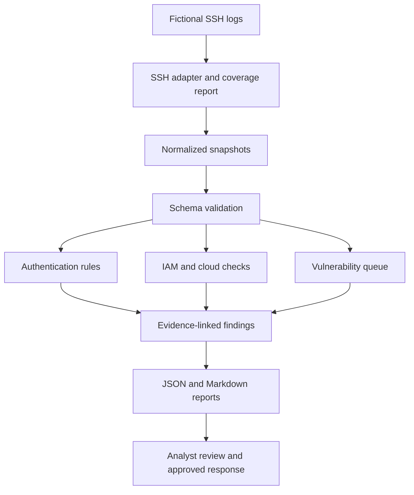

# Architecture and design

The local web exercise is separate from the snapshot pipeline. It starts an ephemeral loopback server, issues GET requests, stores response observations and stops the server. Its `before_after.json` is not silently merged into the synthetic vulnerability queue. The three snapshot vulnerability entries remain fictional records; the web observations show separately executed behavior.

## Trust boundaries

1. Input files are untrusted assessment data. Required fields, booleans, dates, enum values, addresses, port ranges and duplicate IDs are validated before reporting. A limited SSH adapter is included; other source formats need their own adapters.
2. The reporting process reads local files and writes reports. It performs no cloud access, credential entry or network scan. Output directories should be writable only by the reviewer. Reports are not signed or transactionally written as a bundle.
3. Recommended response actions need review. The software does not disable users, revoke sessions, change firewall rules or change storage permissions.

## Example network and encryption design

For an actual small environment, place administrative access behind an approved private access method, restrict source ranges, and log authentication and network policy decisions. Collect host and identity logs centrally and restrict who can read or change them. Confirm service owners before changing rules to avoid locking out administrators.

Encryption in transit, encryption at rest and access control solve different problems. The Azure secure-transfer check reviews a transport-enforcement setting. It does not assess encryption keys, data-at-rest configuration, certificate validity or cipher suites. S3 public-access flags assess a configuration guardrail, not encryption.

The local HTTP server is intentionally plain HTTP on loopback. Adding `Secure` to a cookie is a header exercise; it does not add HTTPS. A production web application needs TLS, real session management, authentication, authorization, security headers, secure deployment and many further controls.

## Scale limits

This is a batch learning tool. It loads all records into memory and retains per-key rolling-window lists. It is unsuitable for high-volume production ingestion. Continuous failures can retain a single burst alert while that burst remains active. A new success after a threshold resets only that user/source/host failure sequence. A real SOC needs alert lifecycle management, event-time lateness policy, retention controls and suppression review.
